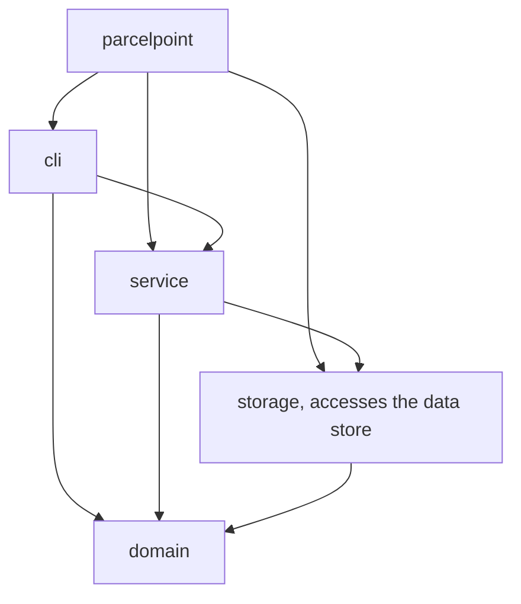
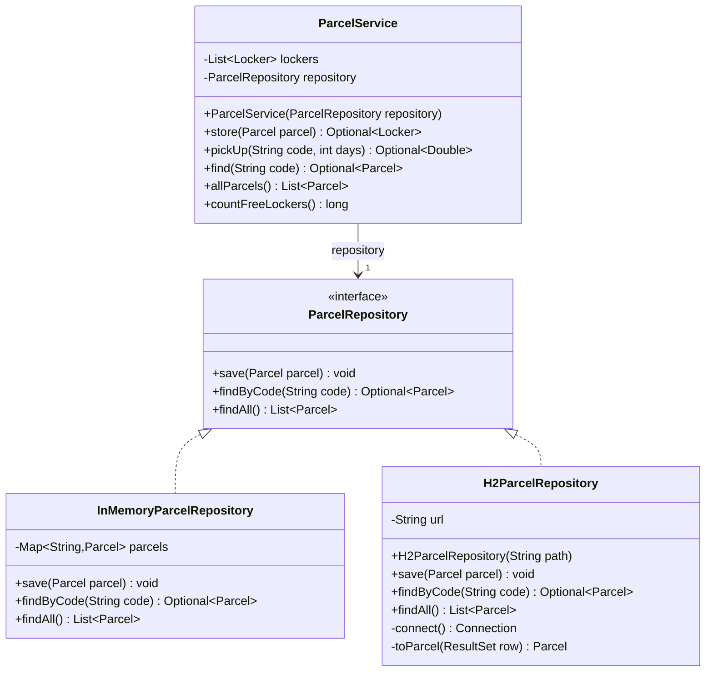
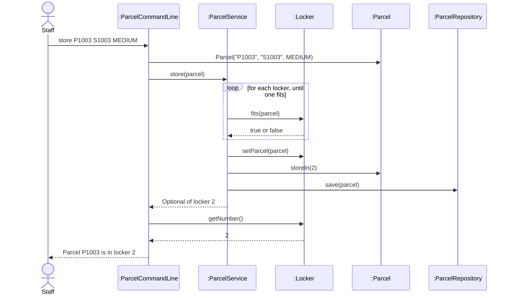

# Lab Report, Designing the Data Management Layer with H2

Repository URL: https://github.com/Xiangbibi/itcs382-h2-lab

## Tools

| Item | Version or name |
| --- | --- |
| JDK | Eclipse Temurin OpenJDK 25.0.5 (Maven runs on OpenJDK 27) |
| Maven | Apache Maven 3.10.0 |
| IDE | macOS Terminal (zsh) and the GitHub web editor |
| AI tool and exact model, if you used one | Claude Opus 5.5 (claude-opus-5-5), Anthropic |

## Part 0. From a store in memory to H2

Commit of the starter, before any change: 66eaa90

0.3 Your prediction for `staff`, written before the second run:

I predict that `staff` will list no parcels and show `Free lockers: 3`, because the program starts again with new, empty objects.

Output of the second run, for `staff` and `quit`:

```text
> staff
Free lockers: 3
> quit
```

State in one sentence where you think the parcels of the first run were kept.

The parcels were kept only in the `LinkedHashMap` of `InMemoryParcelRepository`, in the memory of the running program, which is freed when the program ends.

0.5 The line of Main that you would change to keep the parcels somewhere else:

```java
ParcelRepository repository = new InMemoryParcelRepository();
```

0.6 Commit of the switch to H2: 2ee8f3b

0.7 Output of `SELECT * FROM PARCEL;` after you stored two parcels:

```text
sql> SELECT * FROM PARCEL;
CODE  | STUDENT_ID | PARCEL_SIZE | STATUS | LOCKER_NUMBER
P1001 | S1001      | SMALL       | STORED | 1
P1002 | S1002      | LARGE       | STORED | 3
(2 rows, 7 ms)
```

0.8 Explain why ParcelPoint could not start while the H2 Shell was open, and identify the class that wrote the message `Cannot create the PARCEL table`.

H2 is an embedded database, so the program that opens it locks the file `parcelpoint.mv.db`. While the H2 Shell held the database open, the call to `DriverManager.getConnection` in ParcelPoint failed with an `SQLException` that says `Database may be already in use`. The constructor of `H2ParcelRepository` catches that `SQLException` and throws an `IllegalStateException` with the message `Cannot create the PARCEL table`, so `H2ParcelRepository` wrote the first line, and H2 wrote the `Caused by` line.

0.9 Explain why `staff` shows no parcel while `find` shows each one, and why all three lockers look free.

`find` calls `findByCode`, which runs a real `SELECT ... WHERE CODE = ?` on the PARCEL table, so it finds each stored parcel. `staff` calls `findAll`, which in the starter is only a stub that returns `List.of()`, an empty list, so it lists nothing. The constructor of `ParcelService` rebuilds which lockers are full by calling `repository.findAll()` and putting each waiting parcel back into its locker. Because `findAll` returns an empty list, no locker gets a parcel, so all three lockers look free even though the database holds two stored parcels.

0.11 Your findAll method:

```java
@Override
public List<Parcel> findAll() {
    String sql = "SELECT * FROM PARCEL ORDER BY CODE";
    List<Parcel> parcels = new ArrayList<>();
    try (Connection connection = connect();
         PreparedStatement statement = connection.prepareStatement(sql);
         ResultSet row = statement.executeQuery()) {
        while (row.next()) {
            parcels.add(toParcel(row));
        }
    } catch (SQLException e) {
        throw new IllegalStateException("Cannot read the parcels", e);
    }
    return parcels;
}
```

Commit that adds findAll: 5ad5176

0.12 Output of `SELECT * FROM PARCEL;` after the pickup:

```text
sql> SELECT * FROM PARCEL;
CODE  | STUDENT_ID | PARCEL_SIZE | STATUS    | LOCKER_NUMBER
P1001 | S1001      | SMALL       | PICKED_UP | null
P1002 | S1002      | LARGE       | STORED    | 3
(2 rows, 25 ms)
```

0.13 Optional. Describe what `find P9999'OR'1'='1` showed while the SQL was joined from strings, and what it showed after you put the placeholder back.

While the SQL was joined from strings, `find P9999'OR'1'='1` showed `P1001, S1001, SMALL, PICKED_UP`, although no parcel has that code. The quotes I typed closed the text in the SQL and added the condition `'1'='1'`, which is true for every row, so H2 ran `SELECT * FROM PARCEL WHERE CODE = 'P9999'OR'1'='1'` and returned all rows, and `findByCode` showed the first one. This is SQL injection. After I put the `?` placeholder and `setString` back, the same command showed `No parcel with code P9999'OR'1'='1`, because H2 compared CODE with the whole text as one value.

## Part A. Model the design

A1 Complete the flowchart with one node for each package and one arrow for each dependency, from the package that uses to the package that is used. Mark the package that accesses the data store.



State whether cli depends on storage, and explain why.

No, cli does not depend on storage. `ParcelCommandLine` imports only classes from `domain` and `service`, and it reaches the parcels only through `ParcelService`. Only `service` (through the interface `ParcelRepository`) and `parcelpoint` (where `Main` creates the concrete repository) use `storage`.

A2 Complete the class diagram of the data management layer with ParcelService, the interface ParcelRepository with its three operations, and the two classes that implement it.



A3 Draw a sequence diagram for the command `store P1003 S1003 MEDIUM`, from the staff member to the repository. Show each message as an operation of the class that receives it.



Explain why the last lifeline is the interface ParcelRepository rather than H2ParcelRepository.

`ParcelService` holds its repository in a field whose type is the interface `ParcelRepository`, and its code never names `H2ParcelRepository`, so the message `save(parcel)` is sent to a `ParcelRepository`. Which class receives it is decided only by `Main` at run time. Drawing the interface keeps the diagram true for both the store in memory and H2, which is the point of the Dependency Inversion Principle.

## Part B. Design questions

1. Identify the files that you changed to move from the store in memory to H2, and explain why no other class had to change. Use the terms of this course.

I changed `Main.java`, where two lines (the import and the `new` expression) now create an `H2ParcelRepository`, and `H2ParcelRepository.java`, where I wrote `findAll`. No other class changed because `ParcelService` follows the Dependency Inversion Principle: it depends on the abstraction `ParcelRepository` and receives the object through its constructor (dependency injection), so only `Main`, the one place that names a concrete class, knows which store is used. The interface is the boundary of the data management layer and hides SQL and JDBC (information hiding), so `cli`, `service` and `domain` have low coupling to the data store.

2. The PARCEL table stores the size of a parcel as SMALL, MEDIUM or LARGE rather than as 1, 2 or 3. Identify the type of connascence between ParcelSize and the table in each case, and explain which one is weaker.

Storing SMALL, MEDIUM or LARGE gives connascence of name, because the text in the table must match the name of an enum constant for `name()` and `ParcelSize.valueOf` to work. Storing 1, 2 or 3 gives connascence of convention (meaning), because both sides must agree that 2 stands for MEDIUM, and if the number came from `ordinal()` it would also be connascence of position, since reordering the constants would change the meaning of the stored rows. Connascence of name is weaker: the values are readable in the H2 Shell, and a renamed constant fails at once with an exception instead of silently mapping old rows to the wrong size.

3. Project Phase 2 asks for a data store that needs no separate server. Explain why an embedded database such as H2 meets this rule, and describe the limit of an embedded database that Step 0.8 showed.

H2 runs as a library inside the same Java program, added as one dependency in `pom.xml`, and it keeps its data in a file (`parcelpoint.mv.db`) that it creates on the first run, together with the table from `CREATE TABLE IF NOT EXISTS`. Nothing has to be installed or started before the program runs, so it needs no separate server. The limit shown in Step 0.8 is that the program that opens an embedded database locks its file, so only one program at a time can use it; while the H2 Shell was open, ParcelPoint could not start.

4. State the data store that you would choose for your Project Phase 2 team, files or an embedded database, the requirement that drives the choice, and the package that will access it.

I would choose an embedded database, H2, for our Project Phase 2 team. The requirement that drives the choice is that the data must stay after the program ends and must be searched and updated by key, such as finding or changing one record, which SQL with a primary key and `MERGE` does safely without rewriting a whole file. Only the package `storage` will access the data store, through repository interfaces that the business layer uses, and `Main` will create the H2 repositories.

## AI usage declaration

| AI tool and exact model | Date | Purpose | Files or answers it produced or changed | How you checked its output |
| --- | --- | --- | --- | --- |
| Claude Opus 5.5 (claude-opus-5-5), Anthropic | 13 and 14 November 2026 | Wrote the code changes, the answers and the diagrams, and guided the Git and terminal steps | `Main.java` (2 lines), `findAll` in `H2ParcelRepository.java`, answers 0.3 to 0.13, A1 to A3, B1 to B4 | I built the project with `mvn package` on my Mac and ran the steps of Part 0 myself: `store`, `staff`, `pickup P1001 5` (fee 20.0 baht) and `SELECT * FROM PARCEL;` in the H2 Shell, and the outputs matched the lab sheet. I checked that the diagrams render on GitHub, checked the arrows of A1 against the import lines of each file, and read each answer against the code and the course terms. |
